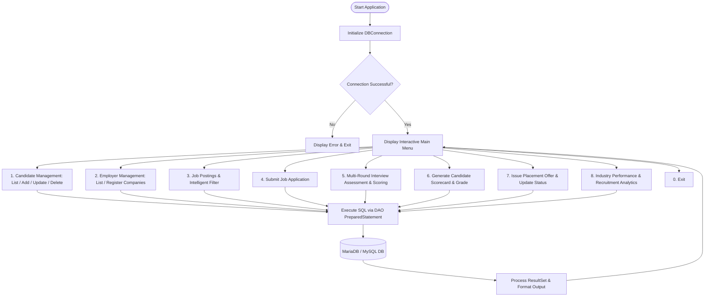

# KONGU ENGINEERING COLLEGE (AUTONOMOUS), PERUNDURAI, ERODE - 638060
### DEPARTMENT OF INFORMATION TECHNOLOGY
### 24ITT32 - PROGRAMMING IN JAVA
---

## INDIVIDUAL PROJECT REPORT
### **EMPLOYMENT & CAMPUS PLACEMENT MANAGEMENT SYSTEM**

**Submitted by:**  
Name: **Maithraan K**  
Email: **maithraan.25it@kongu.edu**  
Department: **Information Technology**  
Regulation: **R2024**  

---

### 1. AIM
To design and develop an end-to-end database-driven **Employment & Campus Placement Management System** using Java Database Connectivity (JDBC) and a relational database (MariaDB / MySQL) to automate candidate registrations, employer postings, applicant tracking, multi-criteria interview assessments, and placement performance analytics.

---

### 2. OBJECTIVES
- Implement a modular, layered software architecture adhering to the **DAO (Data Access Object) Pattern**.
- Manage candidate records, employer registries, job vacancies, and application workflows using normalized relational database tables.
- Enforce business rules, validation constraints, foreign key referential integrity, and cascading deletions.
- Design a weighted multi-criteria continuous assessment evaluation engine for candidate interviews:
  $$\text{Weighted Score} = (\text{Technical} \times 0.40) + (\text{Coding} \times 0.30) + (\text{Communication} \times 0.15) + (\text{HR} \times 0.15)$$
- Automate grade computation (O, A+, A, B+, B, C, RA) and cumulative performance index rating.
- Implement transactional operations (ACID properties) with rollback safety for job application enrollments and placement offer disbursements.
- Provide parameterized SQL queries to prevent SQL injection vulnerabilities.

---

### 3. SYSTEM REQUIREMENTS & SPECIFICATIONS

#### Hardware Requirements:
- Processor: Intel Core i3 / AMD Ryzen 3 or higher
- RAM: 4 GB minimum (8 GB recommended)
- Storage: 500 MB available disk space

#### Software Requirements:
- Operating System: Windows 10/11, Linux, or macOS
- Language: Java Development Kit (JDK 17 or JDK 21)
- Database: MariaDB 10.x+ or MySQL 8.0+
- JDBC Driver: MariaDB Connector/J 3.5.11 / MySQL Connector/J
- Tools: VS Code, IntelliJ IDEA, or Command Prompt / PowerShell

---

### 4. SYSTEM ARCHITECTURE & WORKFLOW

---

### 5. DATABASE SCHEMA

The relational database `employment_portal` contains six interconnected tables:

1. **employers**:
   - `employer_id` (VARCHAR 15, PK)
   - `company_name` (VARCHAR 120, UNIQUE)
   - `industry` (VARCHAR 60)
   - `location` (VARCHAR 80)
   - `contact_email` (VARCHAR 100)
   - `contact_phone` (VARCHAR 20)
   - `website` (VARCHAR 120)

2. **job_seekers**:
   - `seeker_id` (VARCHAR 15, PK)
   - `full_name` (VARCHAR 100)
   - `email` (VARCHAR 100, UNIQUE)
   - `phone` (VARCHAR 20)
   - `qualification` (VARCHAR 60)
   - `skills` (VARCHAR 255)
   - `experience_years` (DECIMAL 3,1)
   - `expected_salary_lpa` (DECIMAL 5,2)

3. **jobs**:
   - `job_id` (VARCHAR 15, PK)
   - `employer_id` (VARCHAR 15, FK referencing `employers`)
   - `job_title` (VARCHAR 100)
   - `department` (VARCHAR 60)
   - `job_type` (ENUM: FULL_TIME, PART_TIME, INTERNSHIP, REMOTE, CONTRACT)
   - `min_experience` (DECIMAL 3,1)
   - `offered_salary_lpa` (DECIMAL 5,2)
   - `required_skills` (VARCHAR 255)
   - `location` (VARCHAR 80)
   - `vacancies` (INT)
   - `status` (ENUM: OPEN, CLOSED, ON_HOLD)
   - `posted_date` (DATE)

4. **applications**:
   - `application_id` (INT, AUTO_INCREMENT, PK)
   - `seeker_id` (VARCHAR 15, FK referencing `job_seekers`)
   - `job_id` (VARCHAR 15, FK referencing `jobs`)
   - `applied_date` (DATE)
   - `cover_note` (VARCHAR 255)
   - `application_status` (ENUM: APPLIED, SHORTLISTED, INTERVIEW_SCHEDULED, SELECTED, REJECTED)
   - UNIQUE KEY (`seeker_id`, `job_id`)

5. **interview_evaluations**:
   - `interview_id` (INT, AUTO_INCREMENT, PK)
   - `application_id` (INT, UNIQUE, FK referencing `applications`)
   - `technical_score` (DECIMAL 5,2, 0-100)
   - `coding_score` (DECIMAL 5,2, 0-100)
   - `communication_score` (DECIMAL 5,2, 0-100)
   - `hr_score` (DECIMAL 5,2, 0-100)
   - `interviewer_remarks` (VARCHAR 255)
   - `interview_result` (ENUM: PENDING, QUALIFIED, NOT_QUALIFIED)

6. **placement_offers**:
   - `offer_id` (INT, AUTO_INCREMENT, PK)
   - `application_id` (INT, UNIQUE, FK referencing `applications`)
   - `offered_ctc_lpa` (DECIMAL 5,2)
   - `joining_date` (DATE)
   - `offer_status` (ENUM: OFFERED, ACCEPTED, DECLINED)

---

### 6. SOURCE CODE IMPLEMENTATION
The project is organized into modular classes:
- **`DBConnection.java`**: Manages MariaDB / MySQL connections with automatic fallback and environment variable support.
- **`JobSeekerDAO.java`**: CRUD operations and skill-based candidate filtering.
- **`EmployerDAO.java`**: Company registrations and opening tallies.
- **`JobDAO.java`**: Vacancy management, job posting, and multi-criteria search.
- **`ApplicationDAO.java`**: Application submission, status transitions, and candidate history.
- **`InterviewDAO.java`**: Continuous multi-round scoring, weighted aggregate evaluation, and reports.
- **`AnalyticsDAO.java`**: Candidate marks card generation, placement offer letters, and sector summary.
- **`MainApp.java`**: Master CLI console dashboard with robust numeric/string validation and exception handling.

---

### 7. RESULTS & DISCUSSION
The **Employment & Campus Placement Management System** was successfully developed and tested under Kongu Engineering College (Autonomous) Regulation 2024 guidelines.

Key outcomes achieved:
1. Complete automation of candidate and recruiter interactions.
2. Objective, formula-driven interview scoring eliminating subjective bias.
3. Automated letter grade generation and formal appointment tracking.
4. Seamless execution using standard Java JDBC and MariaDB/MySQL.

---

### 8. REFERENCES
1. Oracle Corporation, *Java SE Documentation: JDBC Overview & Architecture*, https://docs.oracle.com/javase/8/docs/technotes/guides/jdbc/
2. MariaDB Corporation, *MariaDB Connector/J Developer Reference*, https://mariadb.com/kb/en/about-mariadb-connector-j/
3. MySQL AB & Oracle, *MySQL 8.0 Reference Manual*, https://dev.mysql.com/doc/refman/8.0/en/
4. Kongu Engineering College (Autonomous), *Regulation 2024 (R2024) Academic Curriculum & Guidelines*.
